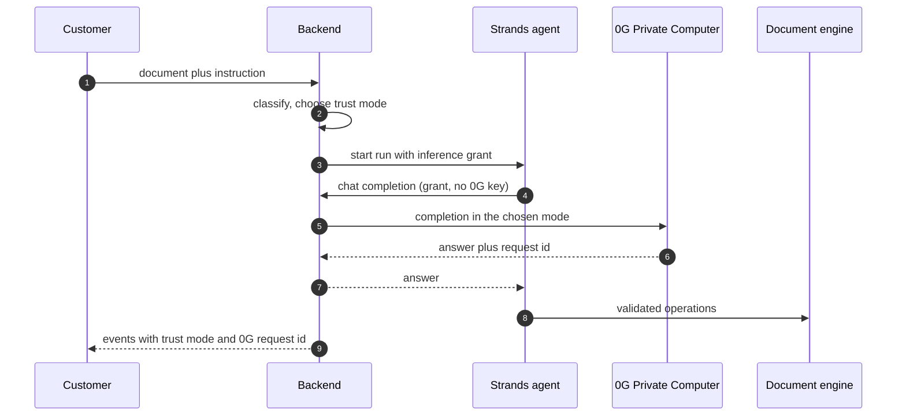
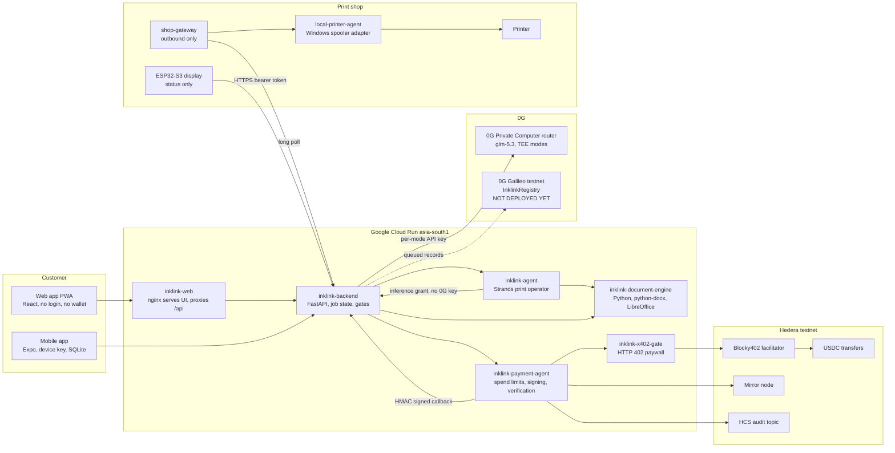
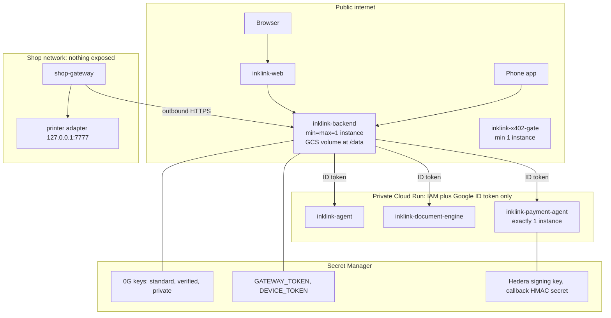
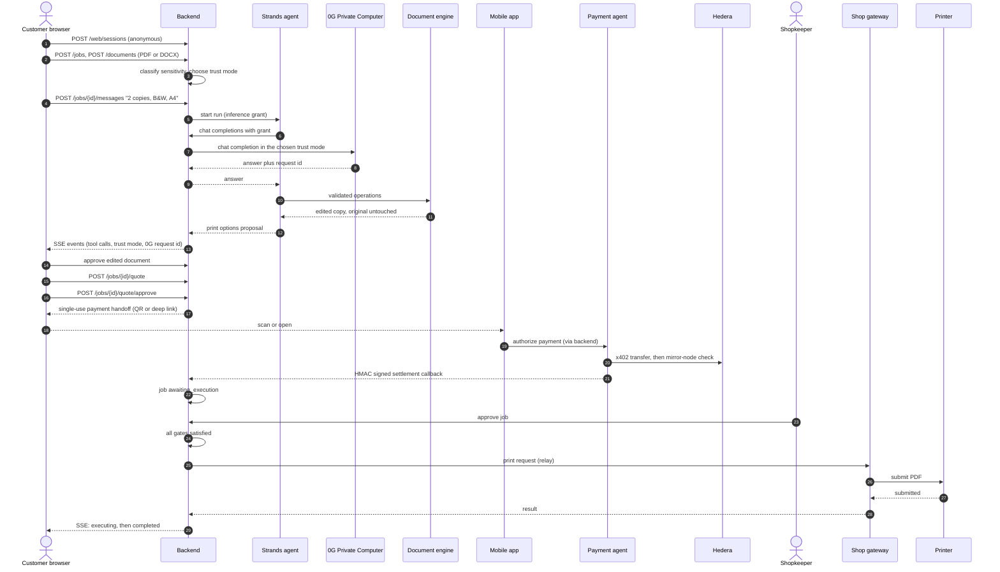
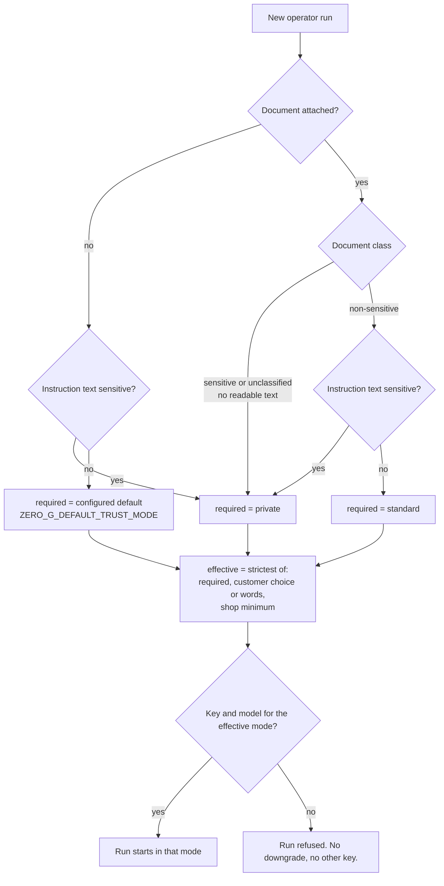
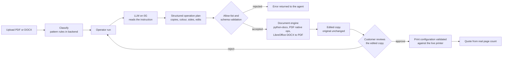
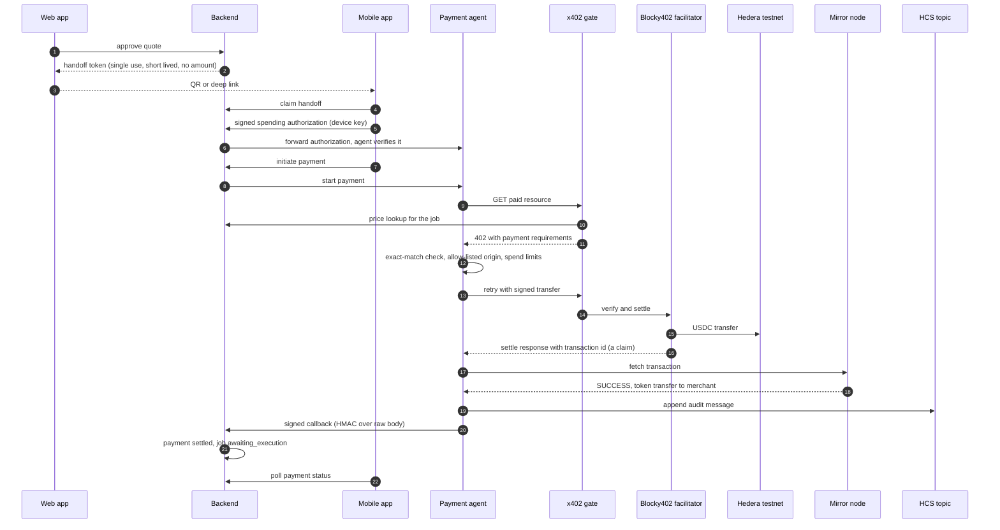
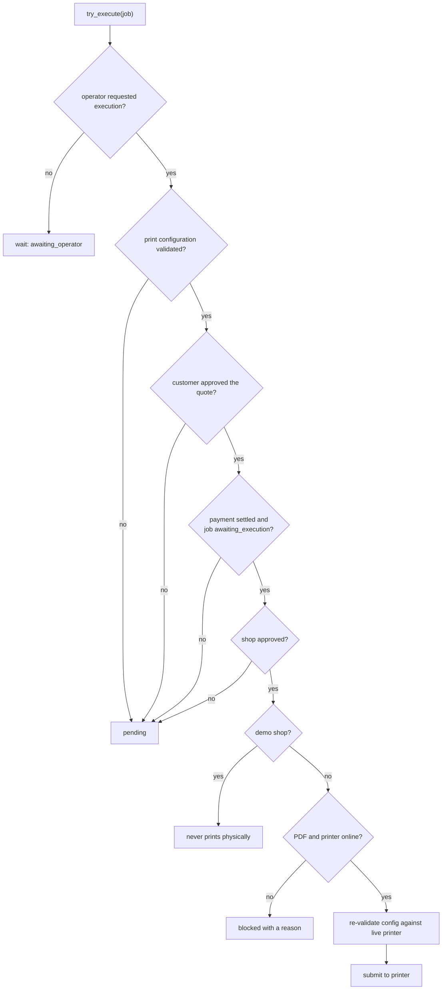
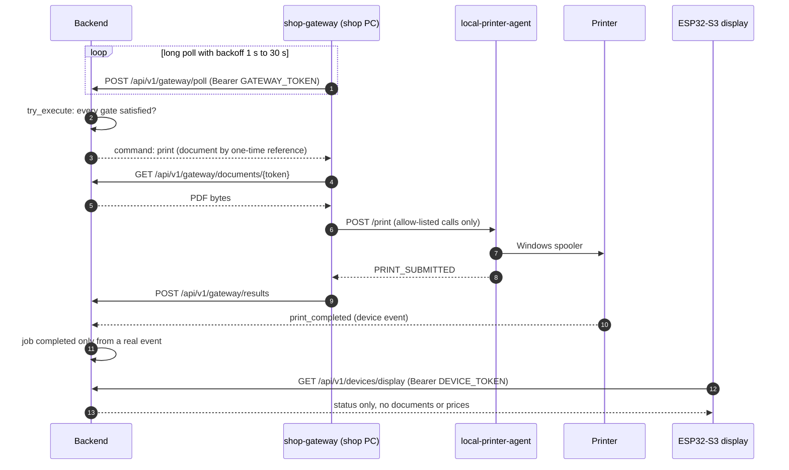
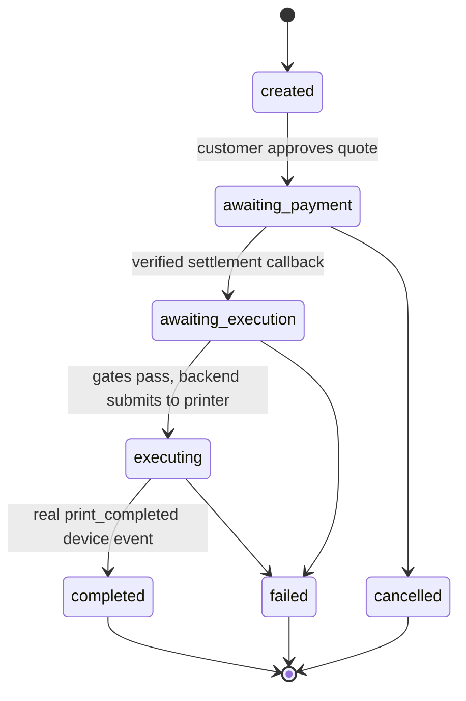

# INKLINK: agentic, privacy-aware printing

> Your Document. Your Agent. Your Control.

Inklink lets a customer send a document from a browser with no account and no wallet, describe what they want in plain language, and have it printed at a participating shop. An AI operator on **0G Private Computer** turns the instruction into structured operations. Deterministic Python code validates and applies them. The customer approves the edited copy and the quote, pays in **USDC on Hedera** from the phone app using **x402**, and the backend prints only after the payment is verified and the shop approves.

Built for **ETHGlobal Mumbai** (Nov 5 to 7, 2026). MIT licensed.

**Status in one paragraph.** The customer flow, the 0G-powered operator, the document engine and the Hedera testnet payment path are live and hosted. The shop printing path (gateway and printer adapter), the ESP32 display firmware and the 0G Galileo audit contract are built but not yet running against the hosted stack, so a physical print has not been demonstrated end to end. The table in [Project status](#project-status) is the source of truth, and nothing in this README claims more than it says.

## Contents

- [Live demo](#live-demo)
- [Built on 0G](#built-on-0g)
- [Hedera x402: the payment agent](#hedera-x402-the-payment-agent-that-pays-for-print-jobs)
- [How it works](#how-it-works)
- [Architecture](#architecture)
- [Project status](#project-status)
- [Repository layout](#repository-layout)
- [Getting started](#getting-started)
- [Shop hardware and offline-first](#shop-hardware-and-offline-first)
- [Technology: integrated vs. not](#technology-integrated-vs-not)
- [Architecture Roadmap](#architecture-roadmap)
- [Documentation](#documentation)
- [Landing page](#landing-page)
- [Team and licence](#team-and-licence)
- [CROPS](#crops)

---

## Live demo

The application is hosted on Google Cloud Run (Mumbai region). No account or wallet is needed to try it.

| What | Link |
|---|---|
| Customer portal | https://inklink-web-765131918851.asia-south1.run.app/portal |
| Judge walkthrough with live checks | https://inklink-web-765131918851.asia-south1.run.app/demo |
| Jury sandbox (full flow, no login, never prints physically) | https://inklink-web-765131918851.asia-south1.run.app/jury |
| Backend health | https://inklink-backend-765131918851.asia-south1.run.app/health |

These responded with HTTP 200 on 2026-11-06. What the hosted demo does and does not show:

- Works: upload, 0G-powered instruction handling with trust modes and request IDs, document editing with review, quote, and the payment handoff to the phone app. Real Hedera testnet payments are made from the Inklink mobile app.
- Does not show: a physical print. That needs the shop gateway and printer adapter running on the shop's computer, and the hosted `/health` currently reports `printer.connected: false`. The jury sandbox can never reach a physical printer by design.

---

## Built on 0G

**Without 0G, Inklink cannot understand a print instruction and has no safe path for sensitive documents: the operator run is refused instead of falling back to a non-private model.** (The jury sandbox has a separate, clearly labelled rule-based operator that uses no model and is refused for real shops.)

### 0G Private Computer in the main user flow

Every AI operator run is an inference on 0G Private Computer (model `glm-5.3`). It is not a side demo. The flow is:

1. The customer uploads a document and writes what they want, for example "2 copies, black and white, A4, double-sided".
2. The backend classifies the document before any model call and picks a trust mode: `standard`, `verified` or `private`. Sensitive or unreadable documents are forced to `private` (TEE-sealed). The customer can raise the mode but never lower it below what the document needs.
3. The backend issues the agent a 15-minute inference grant bound to the job, trust mode and model. **The agent never holds a 0G key.** Each model turn goes through the backend's inference gateway, which calls 0G with the key for exactly that mode.
4. The model proposes structured operations. Deterministic Python code validates and applies them; the model never edits a file.

Code: `services/backend/app/zerog.py` (0G client, `chat_completion`), `services/backend/app/inference.py` (grant and gateway), `services/backend/app/sensitivity.py` (trust-mode policy).

### Request IDs

Each 0G call is logged with its **request ID**, provider, trust mode, model, TEE-verified flag and attestation details. Keys and document content are never logged.

- In the app: Agent Workspace shows a "0G request" row next to the trust mode.
- In the API: `GET /api/v1/jobs/{jobId}` returns `privacy.lastInference.requestId` and `privacy.inferenceCalls`.
- The ID comes from the 0G router's trace metadata, or the `ZG-Res-Key` response header when the trace has none.

The verification shown is the router's provider-level TEE attestation. Inklink does not claim to check a per-response signature itself.

### Why a user comes back

This is the product reasoning, not usage data. We have no retention numbers yet.

- Printing is a repeating need (study material, forms, ID copies, office documents), and the awkward part is configuring a printer dialog and paying. Describing it in one sentence is faster the second time.
- The phone app keeps the paired shop and a local job history, and the web app lists the customer's jobs, so a repeat print starts from a known shop.
- Private documents are the ones people are most reluctant to hand to a print shop or a chatbot. Sealed processing is the reason to trust this over a USB stick or a public computer.
- Not built yet: saved print presets, one-tap reprint, and accounts. Customers are anonymous by design.

### Not implemented for 0G

- **iAI account sign-in and per-user credit consumption.** Inference is paid with the operator's own 0G keys. There is no user sign-in with a 0G account and no per-user balance.
- **On-chain audit on 0G Galileo.** The `InklinkRegistry` contract is written and tested (5 tests) but not deployed, so records queue locally. See `contracts/README.md`.

### Diagram



More diagrams (system context, hosting, payment, OfflinePay, gateway, states, gates, data model) are in the architecture report, [`docs/ARCHITECTURE_REPORT.md`](docs/ARCHITECTURE_REPORT.md). The earlier native-app and payment architecture note is still at [`docs/ARCHITECTURE.md`](docs/ARCHITECTURE.md).

---

## Hedera x402: the payment agent that pays for print jobs

*Owner: Omkar. Code: `services/payment-agent`, `packages/shared-schemas`, `apps/mobile`.*

An AI payment agent pays the print shop **itself**, inside an ordinary HTTP request. The shop's
endpoint answers **HTTP 402 Payment Required** with an x402 price. The agent checks it against the
customer's budget, signs, and settles **USDC on Hedera testnet** through the **Blocky402**
facilitator, which pays the network fee. There is no checkout page, no signup and no API key.

### Proof (real Hedera testnet transactions)

**Paid from the phone, nothing mocked.** The Inklink Android app on a real device: scan the shop
QR, pick the job, approve a budget, pay. End to end through the deployed Cloud Run backend, payment
agent and x402 gate:

| What | Hedera reference |
|---|---|
| **Print job paid from the phone app**: paired with the device key, device-signed budget, agent discovered the endpoint, read the 402 price, paid 0.024 USDC, verified on the mirror node | [`0.0.7162784@1794008216.704679762`](https://hashscan.io/testnet/transaction/0.0.7162784-1794008216-704679762) (payment `payment_831523d3`, HCS entry #9) |

**Full cloud flow driven headlessly** (the app's own API client and device-key signing, against the
same deployed services):

| What | Hedera reference |
|---|---|
| Print job paid end to end: backend quote (2.00 INR = 0.024 USDC), device-signed budget, endpoint discovery, 402 price read, paid, verified, signed callback delivered | [`0.0.7162784@1793992647.222766103`](https://hashscan.io/testnet/transaction/0.0.7162784-1793992647-222766103) (job `job_382a9a8becee`, HCS entry #7) |
| First cloud payment, same flow | [`0.0.7162784@1793986272.588926799`](https://hashscan.io/testnet/transaction/0.0.7162784-1793986272-588926799) (job `job_1b50094f0bb9`, HCS entry #5) |

**Agent runs** (`npm run demo:pay`: dev device key, fixed 0.10 USDC price, stand-in shop account):

| What | Hedera reference |
|---|---|
| Agent discovered the endpoint, read the 402 price, then paid 0.10 USDC (HCS entry #4) | [`0.0.7162784@1793979232.670687781`](https://hashscan.io/testnet/transaction/0.0.7162784-1793979232-670687781) |
| Payment after the concurrency fixes (HCS entry #6) | [`0.0.7162784@1793990131.418337454`](https://hashscan.io/testnet/transaction/0.0.7162784-1793990131-418337454) |
| x402 payment, 0.10 USDC agent → shop (HCS entry #1) | [`0.0.7162784@1793967953.517115964`](https://hashscan.io/testnet/transaction/0.0.7162784-1793967953-517115964) |
| First x402 payment, 0.10 USDC | [`0.0.7162784@1793916490.190691897`](https://hashscan.io/testnet/transaction/0.0.7162784-1793916490-190691897) |
| Spend-audit log (the entries cited on this page) | [topic `0.0.11339168`](https://hashscan.io/testnet/topic/0.0.11339168) |

All are `SUCCESS` on the mirror node. Asset: HTS USDC `0.0.429274`. Agent wallet
`0.0.11330279`, shop wallet `0.0.11227614`, facilitator fee payer `0.0.7162784` (Blocky402).
Anyone can check a payment: `curl https://testnet.mirrornode.hedera.com/api/v1/transactions/<tx id with dashes>`
shows the exact USDC transfer, and the HCS topic shows the matching audit entry.

**OfflinePay from the phone** (a signed promise, settled through the same x402 path; see
[OfflinePay](#offlinepay-pay-later-with-a-signed-promise)):
[`0.0.7162784@1794008511.539597966`](https://hashscan.io/testnet/transaction/0.0.7162784-1794008511-539597966)
(payment `offpay_7a06b5a73ce716ea534b02c0`, HCS entry #10).

### Check it yourself in 60 seconds

Everything is on **Hedera testnet**, so check there (a `/mainnet/` link will not find it).

```bash
# Take the transaction id, swap "@" for "-" and the last "." for "-"
curl -s https://testnet.mirrornode.hedera.com/api/v1/transactions/0.0.7162784-1794008216-704679762 \
  | jq '.transactions[0] | {result, token_transfers}'
```

A correct result has `"result": "SUCCESS"` and a transfer of the exact quoted USDC (token
`0.0.429274`, 6 decimals, so `24000` = 0.024 USDC) from the agent `0.0.11330279` to the shop
`0.0.11227614`. The same payment appears in the audit topic:

```bash
curl -s "https://testnet.mirrornode.hedera.com/api/v1/topics/0.0.11339168/messages?order=desc&limit=5" \
  | jq -r '.messages[] | "\(.sequence_number) \(.message | @base64d)"'
```

Look for the entry whose `paymentId` and `transactionId` match, with `type` `inklink.agent_spend`.

### Claim → code → test → proof

| Claim | Code (`services/payment-agent/src`) | Test (`services/payment-agent/test`) | Proof |
|---|---|---|---|
| Pays only the exact quoted price, to the right shop, in USDC | `payment-agent.ts` (`gate_price_mismatch`), `signing/signing-service.ts` | `gate-discovery.test.ts` (refuses a different 402 price), `gate.test.ts` (exact atomic amounts) | [`…1793979232.670687781`](https://hashscan.io/testnet/transaction/0.0.7162784-1793979232-670687781); `npm run demo:pay -- --negative` refuses and moves nothing |
| Customer-signed spend limits it cannot exceed | `device-auth.ts`, `policy.ts` | `policy.test.ts`, `agent.test.ts`, `app-interop.test.ts` | the budget in each HCS entry |
| No over-limit or double payment under concurrency | `payment-agent.ts` (`initiate`) | `payment-races.test.ts` | logic test |
| Spend kept once a transfer is signed; a lost response is resolved | `x402-client.ts`, `payment-agent.ts` (`resolveOutcome`) | `payment-races.test.ts`, `lost-settlement.test.ts` | logic test (resolver is committed, not yet in the deployed image) |
| Success is verified on the mirror node, not taken from the facilitator | `settlement.ts` | `agent.test.ts` (settles only when the mirror node confirms; otherwise not settled, tx kept), `persistence.test.ts` (re-verifies after a restart), `callback.test.ts` (signed callback) | every transaction above |
| Every spend is logged on Hedera | `hcs-audit.ts` | `hcs-audit.test.ts` | [topic `0.0.11339168`](https://hashscan.io/testnet/topic/0.0.11339168) |
| A real phone pays with x402 | `apps/mobile` (`authorize.tsx`), agent, gate | `apps/mobile/test` (`pairing-device`, `payment-flow`) | [`…1794008216.704679762`](https://hashscan.io/testnet/transaction/0.0.7162784-1794008216-704679762) (HCS #9) |
| A real phone pays with OfflinePay | `offline-settlement.ts`, `apps/mobile/app/offline-pay.tsx` | `offline-settle.test.ts`, `apps/mobile/test/offline-pay*.test.ts` | [`…1794008511.539597966`](https://hashscan.io/testnet/transaction/0.0.7162784-1794008511-539597966) (HCS #10) |

### Known limits

Stated plainly, so the claims above can be trusted:

- **One facilitator** (Blocky402, no fallback) and **testnet only**. Hedera's docs list relying on
  few facilitators as a risk; the official `x402.org` facilitator and Launa also support
  `hedera:testnet`, so a fallback would be a contained change in `src/facilitator.ts`.
- **No request timeouts** on the payment path yet, and a callback that fails all 8 attempts is
  re-sent only on the next restart.
- **Not built:** TLS certificate pinning to the shop gateway, and BLE discovery.
- **Not verified live (the backend's side, not the payment agent's):** a page physically printing
  (the shop gateway and printer are not connected yet) and 0G on-chain records (the contract is not
  deployed). Hedera payments do not depend on either.

### Architecture

```text
Phone app ΓöÇΓöÇsigned budgetΓöÇΓöÇΓû╢ Inklink backend ΓöÇΓöÇbearer tokenΓöÇΓöÇΓû╢ Payment agent ΓöÇΓöÇx402ΓöÇΓöÇΓû╢ x402 gate
 (device key)                (owns quote + amount)            (spend policy,        (HTTP 402,
                                                                signs USDC)          per-job price)
                                   Γû▓                              Γöé                      Γöé
                                   Γöé  HMAC-signed callback        Γöé Blocky402 settles    Γöé
                                   ΓööΓöÇΓöÇΓöÇΓöÇΓöÇΓöÇΓöÇΓöÇΓöÇΓöÇΓöÇΓöÇΓöÇΓöÇΓöÇΓöÇΓöÇΓöÇΓöÇΓöÇΓöÇΓöÇΓöÇΓöÇΓöÇΓöÇΓöÇΓöÇΓöÇΓöÇΓöñ on Hedera testnet ΓùÇΓöÇΓöÇΓöÿ
                                                                  Γö£ΓöÇΓöÇΓû╢ Mirror node: verify transfer
                                                                  ΓööΓöÇΓöÇΓû╢ HCS topic: spend audit entry
```

- **Payment agent** (`services/payment-agent/src/server.ts`): internal service. It holds the only
  wallet key (in `signing/signing-service.ts`; never sent to the app or an LLM).
- **x402 gate** (`src/gate-server.ts`, `src/x402-gate.ts`): `POST /api/v1/jobs/{jobId}/execute`
  answers 402 with the job's price, asked from the backend per job. `GET /discovery/resources`
  publishes the endpoint as an x402 Bazaar resource list. The 402 itself also carries the
  official Bazaar extension, which describes how to call the endpoint.
- **Official x402 packages**: `@x402/core`, `@x402/fetch`, `@x402/express`, `@x402/hedera` and
  `@x402/extensions` (Bazaar).

### Payment flow (no human approves the payment)

1. The customer approves a **budget** once in the app: a per-payment maximum, a total limit, one
   shop and an expiry. The phone signs it with its Ed25519 device key.
2. The backend asks the agent to pay for one job, with the backend-quoted USDC amount.
3. **The agent finds the paid endpoint itself.** It reads the gate's x402 discovery document
   (`/discovery/resources`, Bazaar format) and builds the job's URL from the listed route.
   Then it calls the endpoint without paying and **reads the price from the 402**: amount,
   pay-to account and asset.
4. The agent checks everything: the signed budget, the shop allowlist, the per-payment and total
   limits, the quote expiry, and that the 402 price is **exactly** the quoted amount, pay-to
   account and asset. It reserves the amount, then signs.
5. Blocky402 settles the USDC transfer on Hedera, and the agent gets the paid response.
6. The agent **verifies the transfer on the Hedera mirror node**: right token, right account,
   right amount.
7. The agent writes a **spend-audit entry to HCS** and sends an HMAC-signed callback to the
   backend. The job moves to `awaiting_execution`; a payment never marks a print as completed.

### Spending controls

- A budget that the customer signs on the device (Ed25519), so it can't be forged or replayed.
- A per-payment maximum and a total limit, checked and reserved in one step with no wait in
  between, so two payments at the same time can't together exceed the limit, and a retried request
  returns the same payment instead of paying twice (tests in `test/payment-races.test.ts`).
- Once a transfer has been signed, any later error keeps the spend reserved and marks that funds
  may have moved. The budget is only freed when nothing was signed or the facilitator refused.
- If the settlement response is lost (no transaction id), the agent searches the mirror node for the
  exact agent → shop transfer made after signing. It settles the payment if it finds it, and
  releases the budget only once the transaction's validity window has passed with no such transfer.
- A shop allowlist, plus an allowlist of x402 endpoints the agent may pay.
- An exact-match rule: the agent refuses any 402 that differs from the quoted amount, shop account
  or asset. Live proof: `npm run demo:pay -- --negative`. The gate charged 0.10, the agent was told
  0.11, it refused to sign, and nothing moved.
- Spend limits and nonces survive restarts, which are saved before each change.
- The agent refuses to run if its wallet and the shop wallet are the same account.

### Tamper-evident spend log (HCS)

After every verified payment, the agent appends one message to its HCS topic
[`0.0.11339168`](https://hashscan.io/testnet/topic/0.0.11339168).

- **Only the agent can append.** The topic's submit key is the agent's key.
- **No one can change or delete it.** The topic has no admin key.
- **Each entry contains** the tx ID, amount, shop and budget state after the payment
  (`spentToDate` / `totalSpendingLimit`).
- **No customer data.** Jobs and budgets appear only as SHA-256 commitments.

### OfflinePay: pay later with a signed promise

When the shop can't settle right away, the customer taps **Pay later (OfflinePay)** in the app.
The phone signs a voucher with its device key: a promise to pay exactly this job's backend-quoted
USDC amount, to this shop, valid 30 minutes. It is **not a payment** until it settles.

- **Limits enforced on the phone, the backend and the agent:** 2.00 USDC per promise, 5.00
  unsettled per device across all shops, one promise per job, no replay.
- **Settled through the same x402 path:** the backend asks the agent to settle
  (`POST /api/v1/offline-payments/settle`). The agent checks the voucher again, reads the 402
  price, pays through Blocky402 and verifies on the mirror node.
- **"Paid" only when verified:** the app shows "Paid on Hedera" only after the backend reports a
  mirror-node verified transaction. If the outcome is unknown, it shows "settling" and nobody
  retries, so it is never charged twice.

Code: `packages/shared-schemas/src/offline-pay.ts`, `apps/mobile/app/offline-pay.tsx`,
`services/payment-agent/src/offline-settlement.ts`, backend `services/backend/app/offline_pay.py`.
**Proven from the phone:** "Pay later (OfflinePay)" in the app signed a voucher for 0.024 USDC;
the backend accepted it and the agent settled it on Hedera ΓÇö
[`0.0.7162784@1794008511.539597966`](https://hashscan.io/testnet/transaction/0.0.7162784-1794008511-539597966)
(voucher payment `offpay_7a06b5a73ce716ea534b02c0`, HCS entry #10). An earlier headless run proved
the same path and that resending the identical voucher returns `duplicate` with no second payment
([`0.0.7162784@1794005690.930989293`](https://hashscan.io/testnet/transaction/0.0.7162784-1794005690-930989293),
HCS entry #8).

### Built on Hedera's x402 standard

| Hedera x402 docs | Inklink |
|---|---|
| Exact scheme, `x402Version: 2`, `hedera:testnet` | Same. The agent refuses any other scheme, version or network |
| Amounts in the token's smallest unit | USDC in 6-decimal units, compared as exact integers |
| The facilitator is the fee payer and submits a partially signed `TransferTransaction` | Official `@x402/hedera` scheme; Blocky402 fee payer `0.0.7162784` (checked on `/supported` before paying) |
| The client account must hold and be associated with the token | `npm run setup:wallet -- --associate` |
| payTo aliases can trigger auto account creation | We always pay a plain account ID, so this never happens |
| No native privacy on the ledger | HCS audit entries contain only SHA-256 commitments, never documents or personal data |

**Known tradeoff:** we use one facilitator, Blocky402, with no fallback (a team decision for a
predictable demo). Hedera's docs list relying on few facilitators as a risk; the official
`x402.org` facilitator and Launa also support `hedera:testnet`, so adding a fallback is a
contained change in `src/facilitator.ts`.

### Setup and reproduce

Needs Node 20+ and a Hedera testnet ECDSA account (free at https://portal.hedera.com/).

```bash
cd packages/shared-schemas && npm install && npm run build
cd ../../services/payment-agent && npm install
cp .env.example .env                  # fill in the agent account, key and shop account
npm run setup:wallet -- --associate   # associate USDC with the agent wallet
# get test USDC for the agent at https://faucet.circle.com/ (Hedera Testnet)
npm run setup:wallet                  # until it says "Ready"
npm run setup:audit-topic             # once; put the printed id in HCS_AUDIT_TOPIC_ID
npm run demo:pay                      # real x402 payment; prints the HashScan links
npm run demo:pay -- --negative        # the agent refuses an amount that does not match
npm test                              # 120 tests, no network needed
```

The shop account must also have USDC associated. For a stand-in shop that you control, run
`npm run setup:merchant` (see `docs/ENVIRONMENT.md`).

More detail: `docs/PAYMENT_FLOW.md`, `docs/API_CONTRACTS.md`, `docs/SECURITY.md` and
`docs/INTEGRATION_STATUS.md`.

---

## How it works

The workflow, in order:

```text
Customer -> shop connection -> document submission -> AI interpretation
 -> deterministic document processing -> DOCUMENT approval
 -> shop quotation -> QUOTE approval -> payment -> settlement verification
 -> shop approval -> local print execution
```

Document approval and quote approval are separate stages. Four rules hold the design together:

1. **The LLM never edits a document.** The agent only proposes structured operations. The document engine validates each one against an allow-list and applies it. The original file is never changed, and an edited copy needs the customer's approval.
2. **Privacy is decided before the model runs.** The backend classifies the document and picks a trust mode. Sensitive or unreadable documents are forced into TEE-sealed `private` mode and are never downgraded.
3. **A job is paid only when Hedera says so.** The payment agent verifies the transfer on the mirror node and then sends an HMAC-signed callback. A facilitator response alone is treated as a claim.
4. **Printing needs every gate.** Print configuration validated, quote approved, payment settled and shop approved. The browser, the ESP32 and the agent can never start or confirm a payment or authorize a print.

---

## Architecture

### System context



- The browser never talks to 0G, Hedera or the agent. Everything goes through the backend.
- The dashed line to 0G Galileo is an outbox. The contract is written and tested but not deployed, so records queue locally.

### Hosting and trust boundaries



| Boundary | Rule |
|---|---|
| Browser to backend | Anonymous session token. CORS has no wildcard. |
| Backend to private services | Only the backend service account may invoke the agent, document engine and payment agent. |
| Agent to 0G | The agent never holds a 0G key. It gets a 15-minute grant bound to job, run, trust mode and model. |
| Payment agent to backend | HMAC over the raw request body, sent only after mirror-node verification. |
| Shop to cloud | Outbound connections only. No inbound ports on the shop network. |

### End-to-end print job



### Trust-mode selection

The customer can raise the mode, never lower it below what the document needs (`services/backend/app/sensitivity.py`).



| Mode | Meaning in this project |
|---|---|
| standard | Non-sensitive documents. Any 0G provider, no attestation. |
| verified | Provable execution (TeeML or TeeTLS). The provider may still see plaintext, so it is not used for sensitive documents. |
| private | Personal, financial, identity, confidential or unreadable documents. TeeML only. |

### Document pipeline: AI proposes, Python executes



Known limit: the printer adapter prints PDF only. A DOCX job is blocked at execution with a clear message, because the backend does not yet render DOCX to PDF for printing.

### Payment and settlement (Hedera x402)



The sequence in the Hedera section above shows the same flow with real transaction IDs. [`docs/PAYMENT_FLOW.md`](docs/PAYMENT_FLOW.md) has the full contract.

### Execution gates

All four must be clear before the backend submits to the printer (`pending_gates()` in `services/backend/app/jobs.py`).



### Print execution through the shop gateway



### Job states



Payment states are `created`, `pending`, `awaiting_authorization`, `processing`, `settled`, `failed`, `expired` and `refunded`. `settled` is set only after the mirror-node check and the signed callback.

More diagrams (OfflinePay, data model, shop hardware roles, offline-first status, roadmap) and the 0G evidence checklist are in [`docs/ARCHITECTURE_REPORT.md`](docs/ARCHITECTURE_REPORT.md).

---

## Project status

Checked 2026-11-06. "Live" means running in the hosted stack. "Built" means in the repo and tested, but not exercised end to end in the hosted stack.

| Area | Status | Notes |
|---|---|---|
| Customer web app (PWA, no login, no wallet) | **Live** | `/portal`, `/jury`, `/demo` respond. |
| AI print operator on 0G Private Computer | **Live** | Model `glm-5.3`. Standard, verified and private keys are configured. Request IDs are logged and shown. |
| Document engine | **Live** | python-docx, PDF native operations, LibreOffice conversion. |
| Hedera x402 payments (testnet) | **Live** | Real transactions are recorded in the Hedera section, including a mirror-node check and HCS audit messages. |
| OfflinePay (signed promise, later settlement) | **Built** | Backend ledger and phone screen. Live settlements are recorded in the Hedera section. |
| Native app (Expo) | **Built** | Pairing, document, payment, tracking, OfflinePay. Installed through an EAS build. |
| Shop printing: gateway and printer adapter | **Built, not connected** | Tested. The hosted `/health` reports `printer.connected: false` until the gateway runs on a shop computer. No physical print has been demonstrated. |
| ESP32-S3 display firmware | **Source published, unverified** | `hardware/inklink_display`. Not compiled in CI and not verified on a device or in the simulator by the committer. |
| 0G Galileo registry contract | **Written and tested, not deployed** | Five contract tests. Needs a funded deployer key. Records queue locally until then. |
| 0G Storage | **Not configured** | Documents stay on the backend. Only hashes are prepared for on-chain records. |
| iAI sign-in and per-user credit consumption | **Not built** | Inference is paid with the operator's own 0G keys. |
| Offline execution of authorized jobs | **Not built** | See [Shop hardware and offline-first](#shop-hardware-and-offline-first). |
| Firestore | **Not used** | Backend state is a JSON snapshot on a Cloud Storage volume. |

---

## Repository layout

| Path | Language | Role |
|---|---|---|
| `apps/web` | TypeScript, React, Vite, Tailwind | Customer web app, shop dashboard, Agent Workspace, jury demo |
| `apps/mobile` | TypeScript, Expo, React Native | Customer app: pairing, device key, payment, OfflinePay, tracking |
| `services/backend` | Python, FastAPI | Jobs, sessions, quotes, gates, inference gateway, payment callbacks, device and gateway endpoints |
| `services/strands-agent` | TypeScript, Strands Agents SDK | Print operator agent |
| `services/document-engine` | Python | Deterministic document operations and conversion |
| `services/payment-agent` | TypeScript, Node | Hedera x402 payment agent and x402 gate |
| `services/shop-gateway` | Node | Outbound relay on the shop computer |
| `services/local-printer-agent` | Node | Windows printer adapter on the shop computer |
| `services/mock-gateway` | Node | Mock gateway for development and reference |
| `packages/shared-schemas` | TypeScript | Shared contract types |
| `contracts` | Solidity, Hardhat | `InklinkRegistry` audit contract for 0G Galileo |
| `hardware/inklink_display` | C++ (Arduino) | ESP32-S3 status display firmware |
| `deploy` | Bash, Docker, YAML | Cloud Run scripts, nginx image, compose env |
| `src`, `public`, `index.html` | TypeScript, React, Three.js | Cinematic landing page (see [Landing page](#landing-page)) |
| `docs` | Markdown | Contracts, security, testing, architecture report |

---

## Getting started

### Run the stack locally (Docker)

The same images run on Cloud Run. Everything binds to `127.0.0.1`.

```bash
cp deploy/env/compose.env.example .env      # fill in; .env is git-ignored (Windows: copy)
docker compose up -d --build                # backend, agent, document engine, web
docker compose --profile payments up -d     # adds the Hedera payment agent and x402 gate
```

Open `http://localhost:8080` for the landing page and `http://localhost:8080/portal` for the app.

You need your own credentials for the parts that call out: the three 0G Private Computer keys for real AI runs, and a funded Hedera testnet agent account for payments. Without a 0G key, real jobs are refused. The jury sandbox at `/jury` has a clearly labelled rule-based operator that uses no model and cannot reach a physical printer.

The printer stays on the host. Run `services/local-printer-agent` (port 7777) and the compose backend reaches it through `host.docker.internal`.

Where every variable goes: [`ENVIRONMENT_SETUP.md`](ENVIRONMENT_SETUP.md). Image details: [`DOCKER_DEPLOYMENT.md`](DOCKER_DEPLOYMENT.md). Backend without Docker: [`BACKEND_SETUP.md`](BACKEND_SETUP.md).

### Run the tests

| Component | Command |
|---|---|
| Backend | `cd services/backend && python -m pytest -q tests` |
| Web | `cd apps/web && npm test` and `npm run build` (type-check and build) |
| Mobile | `cd apps/mobile && npm test` and `npm run typecheck` |
| Payment agent | `cd services/payment-agent && npm test` |
| Shop gateway | `cd services/shop-gateway && npm test` |
| Printer adapter | `cd services/local-printer-agent && npm test` |
| Strands agent | `cd services/strands-agent && npm run test:unit` |
| Contracts | `cd contracts && npm test` |

More: [`docs/TESTING.md`](docs/TESTING.md).

### Deploy to Google Cloud Run

The scripts in `deploy/gcp/` run in this order from Cloud Shell: `00-preflight`, `01-enable-apis`, `02-create-resources`, `05-configure-secrets`, `03-build-images`, `04-deploy-services`, `06-deploy-frontend`, `07-verify-deployment`. They are hard-pinned to our Google Cloud project (`PROJECT_ID`, `PROJECT_NUMBER` and `ORGANIZATION_ID` in `deploy/gcp/lib.sh`) and stop on any other active project. Deploying a copy to your own project means editing those values; we have not tested that. After the first deploy, always run `SKIP_PAYMENT_AGENT=1 bash deploy/gcp/04-deploy-services.sh` once the payment agent is live, so a running payment agent is not redeployed mid-payment. Full guide: [`CLOUD_SHELL_DEPLOYMENT.md`](CLOUD_SHELL_DEPLOYMENT.md) and [`deploy/gcp/README.md`](deploy/gcp/README.md).

### Run the shop computer pieces

On the machine connected to the printer: start `services/local-printer-agent`, then `services/shop-gateway` with the backend URL and `GATEWAY_TOKEN`. Then check `/health` for `printer.connected: true` and pick the printer in Shop configuration. Steps: [`HARDWARE_GATEWAY_SETUP.md`](HARDWARE_GATEWAY_SETUP.md).

---

## Shop hardware and offline-first

The shop side has three physical roles that are easy to confuse, and an offline-first goal that is only partly built. This section separates what exists from what is planned. Printing today needs the backend online.

Shop hardware runs on the shop network and makes outbound connections only. The ESP32 firmware source is in [hardware/](hardware/README.md), and the shop computer setup is in [HARDWARE_GATEWAY_SETUP.md](HARDWARE_GATEWAY_SETUP.md).

### What each shop-side component is

| Component | Role | It is not |
|---|---|---|
| Printer | Produces paper. | |
| Local printer adapter (`local-printer-agent`) | Windows spooler adapter on `127.0.0.1:7777`. Discovers printers and submits a validated PDF. | A job queue or history store. |
| Shop gateway (`shop-gateway`) | Outbound-only connector. Long-polls the backend, runs only four allow-listed adapter calls, fetches the PDF through a one-time reference, and reports results. Also serves read-only status on the shop LAN for the display. | A durable queue. It decides nothing about authorization. |
| ESP32-S3 interface | Status display and local interaction for the shop, talking to the backend over authenticated HTTPS (`/api/v1/devices/heartbeat`, `/events`, `/display`). | A PDF renderer, a print gateway, or a payment actor. It never starts or verifies payments. |

### Offline-first: what is implemented and what is not

The intent is to move intelligence toward the physical printer so that printing does not depend on an always-on cloud. This table says how far that has gone today.

| Capability | Status | Evidence / gap |
|---|---|---|
| Shop hardware stays on the shop network; only outbound connections | **Implemented** | `shop-gateway` makes outbound calls only. |
| Backend and printer on the same LAN with no relay (`PRINTER_MODE=direct`) | **Implemented** | `services/backend/app/config.py`. Payment and inference still need internet. |
| Gateway reconnects with backoff after a network error or backend restart | **Implemented** | `gateway.mjs` (1 s to 30 s with jitter). |
| Gateway retries reporting a result a few times | **Partial** | Retries are in memory only. A gateway crash loses an unreported result. |
| Device heartbeat, online/offline detection | **Implemented** | `services/backend/app/devices.py`. |
| Print completion only from a real device `print_completed` event for a job the backend submitted | **Implemented** | `devices.py`. |
| Durable outbox with retry for on-chain audit records | **Implemented (backend)** | `chain.py` queues records and sends them when configured. Today 32 are queued because no contract is deployed. |
| Offline payment promise (OfflinePay voucher) with later settlement | **Implemented (app and backend)** | `apps/mobile/src/offline`, `services/backend/app/offline_pay.py`. A voucher becomes settled only through the signed settlement callback, so it does not bypass payment verification. |
| Local SQLite persistence | **Mobile app only** | `apps/mobile/src/db/database.ts`. The gateway has no SQLite. The backend persists a JSON snapshot. |
| Durable local print queue on the shop machine | **Not implemented** | Planned (Phase 2). |
| Executing a previously authorized job while the internet is down | **Not implemented** | The gateway holds no cached job and no authorization it can verify locally. Printing today needs the backend online. |
| Idempotent two-way sync, conflict handling, crash recovery for jobs | **Not implemented** | Planned (Phase 2). |
| Local document processing without the cloud | **Not implemented** | The document engine runs on Cloud Run. Packaging it for the shop machine is planned. |

**Security rule for any future offline mode.** Offline execution must never bypass payment verification or print authorization. A job may run offline only if the backend has already issued an authorization that the gateway can verify locally, for example an expiring, job-bound token signed with a key whose public half the gateway has pinned, issued only after the settlement callback. The gateway must not treat an arbitrary cached job as authorized. That signed authorization does not exist yet.

**What a sync design would need (not built).** A SQLite job table on the shop machine with a state column, an idempotency key per job and event so replays are harmless, a rule that the backend is the source of truth for authorization while the gateway is the source of truth for physical status, retries with backoff, and replay of unsent `print_started`, `print_completed` and `print_failed` events on reconnect. Treat all of this as design work, not a feature.

### Cloud cannot do without vs. local can do

Cloud-dependent today: AI interpretation on 0G Private Computer, document processing, cross-shop discovery, quotation, Hedera x402 initiation and settlement verification, and the print authorization decision.

Local today: talking to the printer, reporting device status, and a LAN-only deployment of the backend with `PRINTER_MODE=direct`.

---

## Technology: integrated vs. not

Only what the repository actually contains is listed as integrated.

| Area | Integrated | Notes |
|---|---|---|
| Web frontend | React 18, TypeScript, Vite, Tailwind CSS, React Router | `apps/web` |
| Mobile | React Native, Expo (expo-router), TypeScript | `apps/mobile` |
| Backend | Python FastAPI on Google Cloud Run | `services/backend` |
| Node services | Express (payment agent, x402 gate), Node.js (gateway, printer adapter, Strands agent) | |
| AI | Strands Agents SDK, 0G Private Computer, GLM-5.3 (`glm-5.3`) | Trust mode is chosen per document. |
| Document processing | Python engine, python-docx, LibreOffice (DOCX to PDF) | `services/document-engine` |
| Payments | Hedera Testnet, Hedera x402 (`@x402/*`, `@hiero-ledger/sdk`), Blocky402 testnet facilitator, HCS audit topic | Facilitator set by `FACILITATOR_URL`. |
| 0G chain | `InklinkRegistry.sol` (Solidity 0.8.24), Hardhat, ethers.js, eth-account | Tested. **Not deployed yet**; records queue locally. |
| Data | SQLite (mobile app), JSON snapshot on a Cloud Storage volume (backend) | |
| Hardware | Local printer adapter, shop gateway | The ESP32-S3 firmware in `hardware/` is published as standalone open-source code (see `hardware/README.md`). |

Not integrated, despite appearing in plans:

- **Firestore.** The repository has no Firestore code. Backend state is a JSON snapshot.
- **ESP32-S3 firmware: published, not part of the application build.** The hardware code (Arduino, SSD1306 OLED, buttons, LEDs, buzzer) is in `hardware/inklink_display` so it is open source too. It is a standalone sketch: nothing in the web app, backend or mobile app builds or depends on it. It has not been compiled in CI, and I have not verified it on a device or in the simulator.
- **Local SQLite in the gateway**, **local document processing**, and **offline authorized printing** (see the table above).
- **0G Galileo contract on-chain.** Written and tested, awaiting deployment.

---

## Architecture Roadmap

These are goals, not completed functionality.

### Phase 1: Connected printing infrastructure (current)

- Customer-to-shop workflow with no customer account.
- AI-assisted editing with deterministic execution.
- Separate document approval and quote approval.
- Payment coordination and settlement verification on Hedera.
- Connected shop gateway and printer adapter.
- ESP32 device heartbeat, events and status display endpoints.
- Remaining to finish Phase 1: run the shop gateway against the live backend, deploy the 0G registry contract, and prove one full print on real hardware.

### Phase 2: Offline-first local infrastructure

- Durable SQLite print queue on the shop machine.
- A backend-issued, job-bound, expiring print authorization that the gateway verifies locally, so a paid and approved job can finish during an internet outage.
- Idempotent synchronization of print status, with retries and replay of unsent events after reconnect.
- Safe recovery after a power or network interruption.
- Local document processing where it is technically feasible.
- Better printer integrations beyond the Windows spooler.

### Phase 3: Distributed and decentralized infrastructure

- Reduce dependence on a single hosted backend.
- Independently operated shop gateways.
- Distributed shop discovery.
- Alternative RPC providers for Hedera and 0G reads and writes.
- Independent verification of settlement from public chain data.
- Decentralized coordination and verifiable execution.
- Stronger privacy-preserving computation.

---

## Documentation

| Document | What it covers |
|---|---|
| [`docs/ARCHITECTURE_REPORT.md`](docs/ARCHITECTURE_REPORT.md) | Full architecture report with all diagrams and the 0G evidence checklist |
| [`docs/ARCHITECTURE.md`](docs/ARCHITECTURE.md) | Native app and payment architecture |
| [`docs/API_CONTRACTS.md`](docs/API_CONTRACTS.md), [`docs/WEB_CONTRACTS.md`](docs/WEB_CONTRACTS.md) | Request and response shapes |
| [`docs/PAYMENT_FLOW.md`](docs/PAYMENT_FLOW.md) | Payment sequence |
| [`docs/SECURITY.md`](docs/SECURITY.md) | Security properties |
| [`docs/TESTING.md`](docs/TESTING.md) | How things are tested |
| [`docs/INTEGRATION_STATUS.md`](docs/INTEGRATION_STATUS.md) | What is integrated and what is pending |
| [`docs/OPERATOR_EVENTS.md`](docs/OPERATOR_EVENTS.md) | Operator event stream |
| [`docs/DEMO.md`](docs/DEMO.md), [`JURY_DEMO_GUIDE.md`](JURY_DEMO_GUIDE.md) | Demo walkthroughs |
| [`DEPLOYMENT_ARCHITECTURE.md`](DEPLOYMENT_ARCHITECTURE.md) | Cloud Run topology and secrets |
| [`SMART_CONTRACT_INTEGRATION.md`](SMART_CONTRACT_INTEGRATION.md), [`contracts/README.md`](contracts/README.md) | Registry contract |
| [`NATIVE_APP_INTEGRATION.md`](NATIVE_APP_INTEGRATION.md) | Native app and backend integration |
| [`hardware/README.md`](hardware/README.md) | ESP32-S3 firmware |

---

## Landing page

The repository root also holds the cinematic landing page for INKLINK (`src/`, `public/`, `index.html`). It is a continuous WebGL environment, a procedural printing workshop that the camera travels through as you scroll. It tells the story **Documents, Intelligence, Local Connectivity, Autonomous Payments, Physical Execution**. In the hosted stack it is served by the same nginx image as the web app.

```bash
npm install
npm run dev      # http://localhost:5173
npm run build    # type-check and production build to /dist
npm run qa       # with the dev server running: renders every chapter and saves screenshots
```

Stack: React 18, TypeScript, Vite, Three.js with React Three Fiber and Drei, GSAP, Tailwind CSS, lucide-react. External links are configured with `VITE_INKLINK_APP_URL`, `VITE_INKLINK_GITHUB_URL`, `VITE_INKLINK_DISCORD_URL` and `VITE_INKLINK_CONTACT_EMAIL` in `.env.local`.

Brand palette: Ink Black `#111111`, Paper White `#FAFAF7`, Signal Orange `#F15A36`, Graphite `#777777`, Light Grey `#EAEAE7`.

Accessibility and performance: a WebGL fallback renders a static gradient if 3D is unavailable, `prefers-reduced-motion` disables float, parallax and the GSAP hero timeline, rendering scales across low, mid and high tiers, and the page has a skip link, semantic landmarks and visible focus styles.

The site communicates the product vision without fabricating metrics, deployments, testimonials or partnerships. Its distinction between what works locally and what needs connectivity, and that offline authorization is not completed on-chain settlement, matches this README.

---

## Team and licence

- **Danish**: backend, web app, Agent Workspace, document and agent services, shop gateway and printer adapter, deployment, the registry contract, hardware firmware publication, landing page.
- **Omkar**: native app, Hedera x402 payment agent and gate, OfflinePay rules.

Licensed under the MIT licence. See [`LICENSE`](LICENSE).

---

## CROPS

Lead property: **Privacy (P)**. Censorship resistance is the weakest property today and is stated as a trade-off.

**C: Censorship resistant.** *Partial, and honest about it.* Users depend on our Cloud Run backend and domain, on one Hedera mirror node and facilitator, and on the 0G router. If our backend goes away the web app stops. A shop can run the whole backend on its own computer (`PRINTER_MODE=direct`), but it still needs 0G inference and Hedera. Independent gateways and alternative RPC providers are Phase 3 goals, not features.

**O: Open source.** *Yes.* MIT licence. The repo contains the web app, mobile app, backend, document engine, agents, payment agent, gateway, printer adapter, deploy scripts and contracts. A user can build and run it from the repo with their own 0G, Hedera and Google Cloud credentials. See `docs/` and `deploy/gcp/README.md`.

**P: Private.** *Lead property.*
- Customers need no account, name or wallet in the browser. Sessions use random tokens.
- The backend classifies each document before any model call. Sensitive or unreadable documents run in `private` mode (TeeML on 0G Private Computer) and are never downgraded. A missing key stops the run instead of falling back.
- The 0G keys, gateway token and device token stay on the server. They are never sent to the browser or the agent.
- The web client has no third-party trackers or analytics.
- What others learn: Google Cloud hosts the backend and sees traffic and stored state; the 0G provider sees prompts in Standard and Verified modes (not in Private); the Hedera ledger and HCS topic are public and show the paying account, merchant, amount and a payment ID, but no document content; the ESP32 receives job status only, never documents, file names, INR prices or customer data.
- Limit: this is not anonymity. A Hedera payer account is public, and the backend sees the document in order to process it.

**S: Secure.**
- Payments are authorized in the mobile app with a device key held in secure storage. The browser never takes payment.
- A job counts as paid only after the payment agent verifies the transaction on the Hedera mirror node and sends an HMAC-signed callback. There is no simulated settlement for real jobs.
- Pairing uses a signed shop QR, a pinned Ed25519 gateway key and a single-use challenge.
- The gateway makes only outbound calls and can run only four allow-listed adapter calls. The PDF is fetched through a one-time reference.
- The payment agent, agent and document engine are private Cloud Run services reachable only with Google ID tokens, and CORS has no wildcard.
- Trust assumptions: our backend and Cloud Run project, the Hedera mirror node, the 0G provider's TEE attestation (a provider-level attestation, not a per-response signature check), and a shared gateway token and device token (per-device tokens are not built).
