# Inklink architecture report

Diagrams are Mermaid and render on GitHub. Every box and arrow below was checked against the code in this repository. Where something is planned or not deployed, the diagram says so.

Status legend used in this document: **live** (running in the hosted stack), **built** (in the repo and tested, not exercised end to end in the hosted stack), **planned** (not built).

Contents

1. System context
2. Hosting and trust boundaries
3. End-to-end print job (sequence)
4. 0G Private Computer inference and request IDs (sequence)
5. Trust-mode selection (flowchart)
6. Document pipeline: AI proposes, Python executes
7. Hedera x402 payment and settlement (sequence)
8. OfflinePay (sequence)
9. Print execution through the shop gateway (sequence)
10. Job and payment states
11. Execution gates
12. Data model
13. Shop hardware roles
14. Offline-first status
15. Roadmap
16. Evidence checklist for the 0G criteria

---

## 1. System context

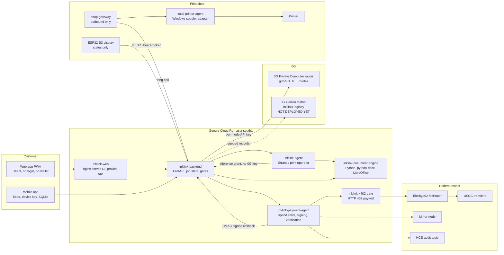

Notes

- The browser never talks to 0G, Hedera or the agent. Everything goes through the backend.
- The dashed line to 0G Galileo is an outbox. The contract is written and tested, not deployed, so records queue locally.

---

## 2. Hosting and trust boundaries

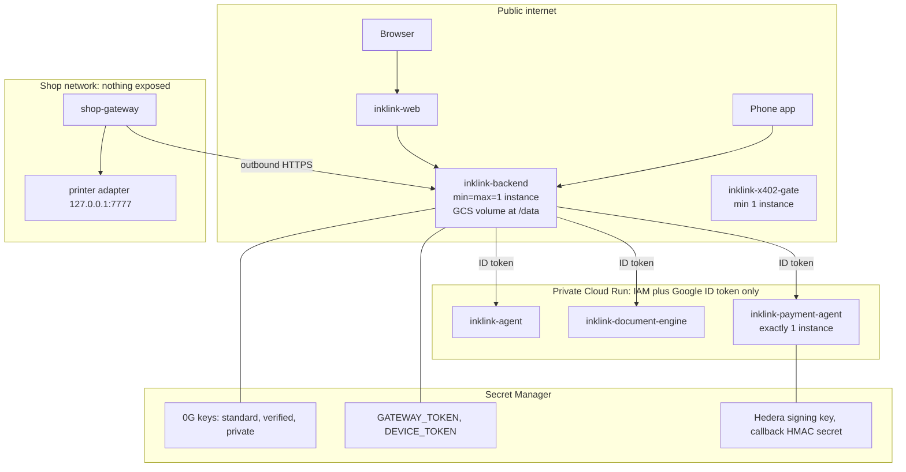

What each boundary protects

| Boundary | Rule |
|---|---|
| Browser to backend | Anonymous session token. CORS has no wildcard. |
| Backend to private services | Only the backend service account may invoke them. |
| Agent to 0G | The agent never holds a 0G key. It gets a 15-minute grant bound to job, run, trust mode and model. |
| Payment agent to backend | HMAC over the raw request body, sent only after mirror-node verification. |
| Shop to cloud | Outbound connections only. No inbound ports on the shop network. |

---

## 3. End-to-end print job

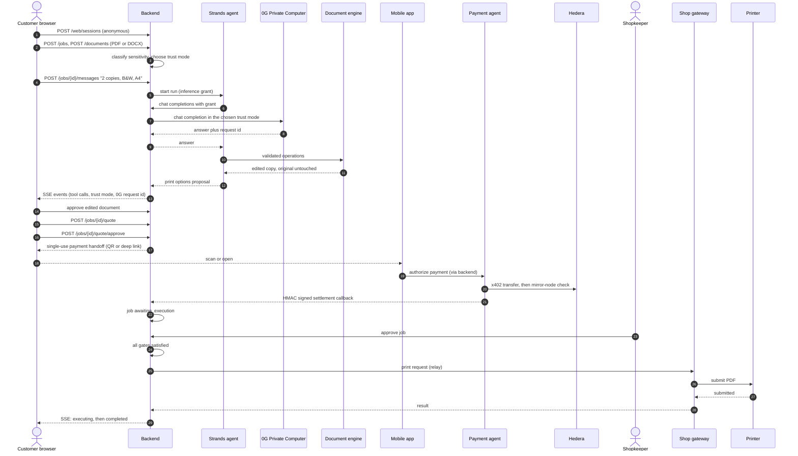

Document approval and quote approval are separate steps (steps 14 and 16-17).

---

## 4. 0G Private Computer inference and request IDs

This is the 0G path in the main user flow. The agent is a Strands `OpenAIModel` whose base URL is the backend's own inference gateway.

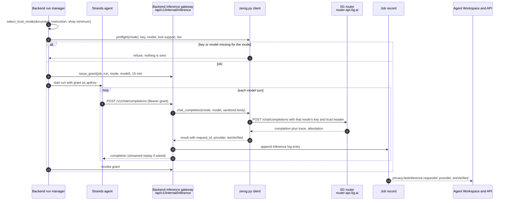

What is recorded per inference call (`services/backend/app/inference.py`): time, run id, trust mode, model, provider, **request id**, TEE-verified flag, verification result, TEE type and verifier. The last 30 calls are kept per job.

Where the request ID shows up

| Place | How |
|---|---|
| Agent Workspace panel | Row "0G request" under the trust mode (`apps/web/src/workspace/Panels.tsx`). |
| Job API | `GET /api/v1/jobs/{jobId}` returns `privacy.lastInference.requestId`, and `privacy.inferenceCalls` is the count. |

The request ID comes from the 0G router's trace metadata, or from the `ZG-Res-Key` response header when the trace has none (`services/backend/app/zerog.py`).

Rules enforced by the client

- A request in mode M uses only mode M's key. It never substitutes another mode's key.
- The model is pinned. Body-level routing overrides (`provider`, `verify_tee`, `model`, `stream`) are stripped.
- The upstream response is fetched non-streaming so verification is known before output reaches the agent.

What is claimed about verification: the router reports `teeVerified` and a provider attestation. That is a provider-level attestation, not a per-response signature check done by Inklink.

---

## 5. Trust-mode selection

From `services/backend/app/sensitivity.py`. The customer can raise the mode, never lower it below what the document needs.

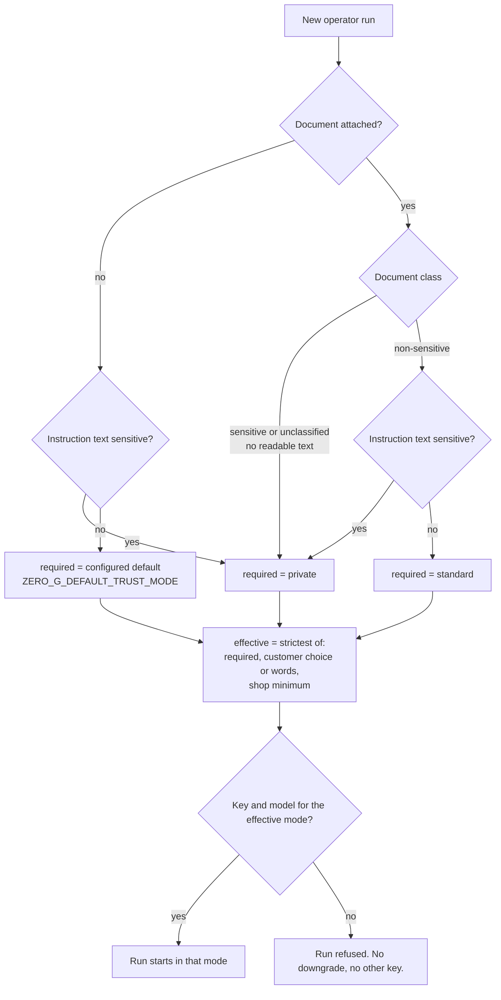

Customer wording is read too: "private", "confidential" and similar words raise to `private`; "verified", "provable", "auditable" raise to `verified`.

| Mode | Meaning in this project |
|---|---|
| standard | Non-sensitive documents. Any 0G provider, no attestation. |
| verified | Provable execution (TeeML or TeeTLS). The provider may still see plaintext, so it is not used for sensitive documents. |
| private | Personal, financial, identity, confidential or unreadable documents. TeeML only. |

---

## 6. Document pipeline: AI proposes, Python executes

The model never edits a file. It proposes structured operations. Deterministic code validates and applies them.

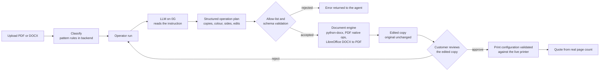

Known limit: the printer adapter prints PDF only. A DOCX job is blocked at execution with a clear message, because the backend does not yet render DOCX to PDF for printing.

---

## 7. Hedera x402 payment and settlement

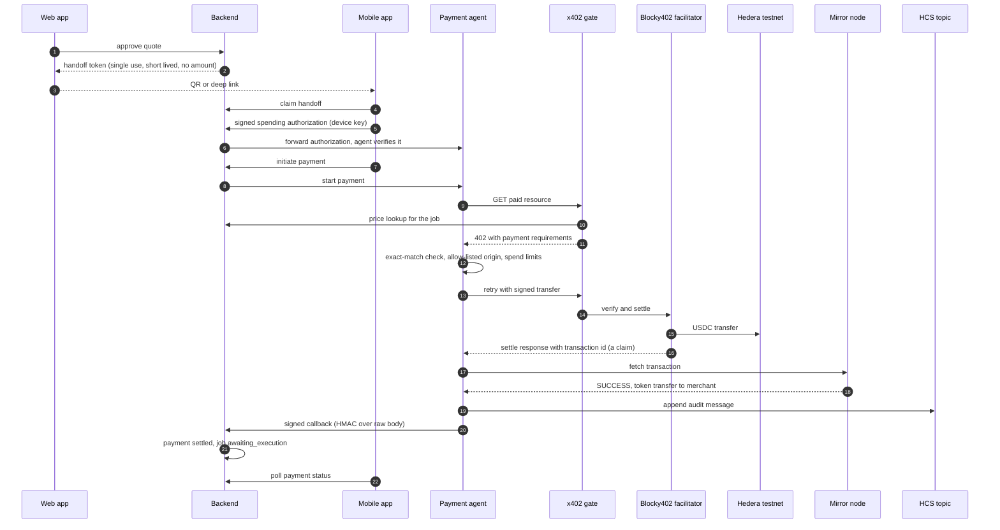

Rules that matter

- A facilitator response with a transaction ID is a **claim**. Only the mirror-node check marks the payment settled.
- If the settlement response is lost, the agent searches the mirror node for the exact transfer instead of guessing (`resolveOutcome` in the payment agent).
- The callback is idempotent on `paymentId` and moves the job to `awaiting_execution`, never to `completed`.
- Browser and ESP32 never initiate or verify payments.

Real evidence is in the README Hedera section (transaction IDs, HCS sequence numbers, and a 60-second self-check).

---

## 8. OfflinePay

A signed promise to pay, settled on Hedera later. It does not skip verification: the job is not paid until the same signed settlement callback arrives.

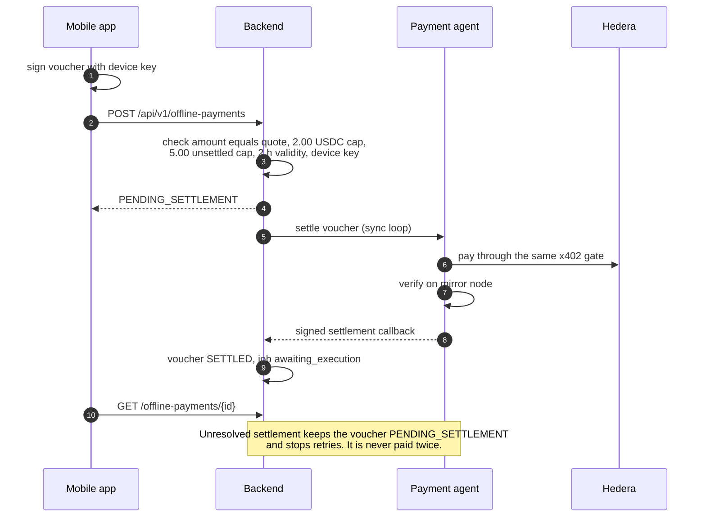

---

## 9. Print execution through the shop gateway

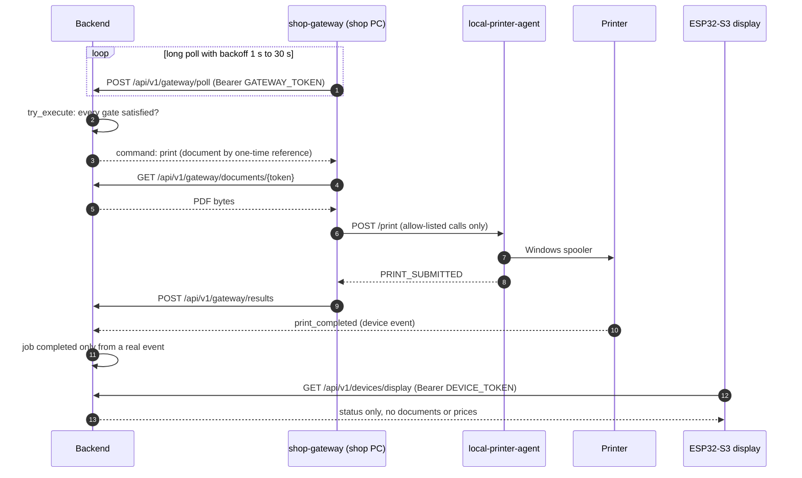

Status: the gateway and adapter are built and tested. They have not yet been run against the hosted backend (`/health` reports `printer.connected: false`), so a physical print has not been demonstrated end to end.

---

## 10. Job and payment states

Job states (`JobStatus`):

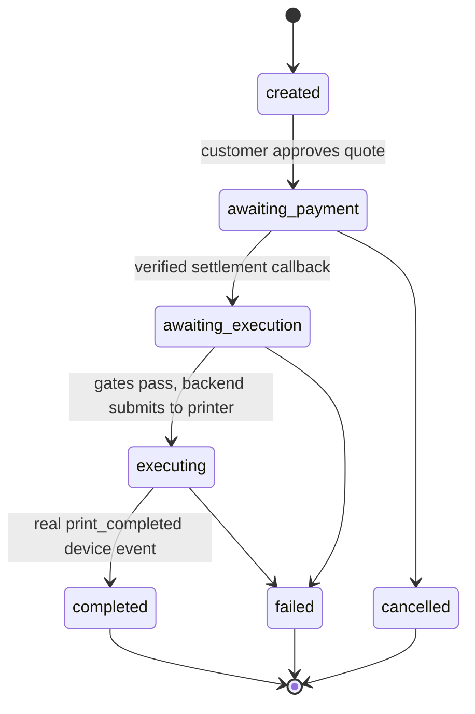

Payment states (`PaymentStatus`): `created`, `pending`, `awaiting_authorization`, `processing`, `settled`, `failed`, `expired`, `refunded`. `settled` is set only after the mirror-node check and the signed callback. The diagram above shows the main path and terminal states, not every transition.

---

## 11. Execution gates

`pending_gates()` in `services/backend/app/jobs.py`. All four must be clear before `try_execute` submits.

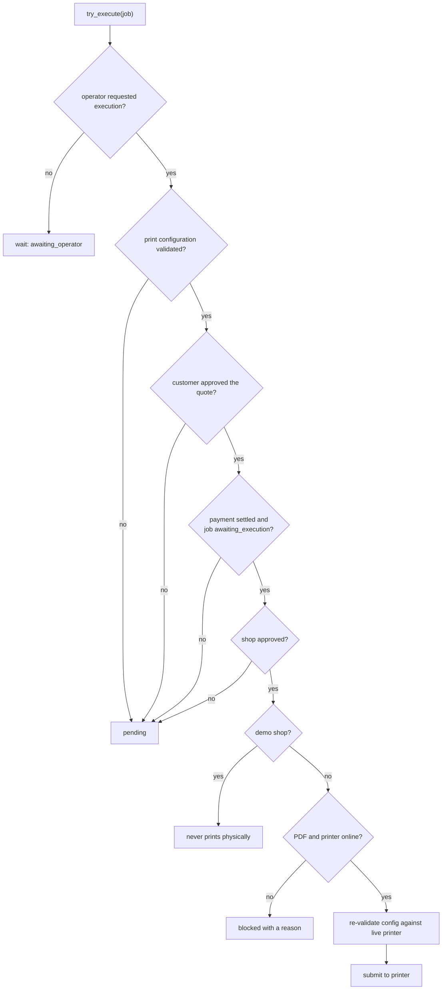

---

## 12. Data model

Backend state is a JSON snapshot persisted to a Cloud Storage volume. This is the logical shape, not a SQL schema.

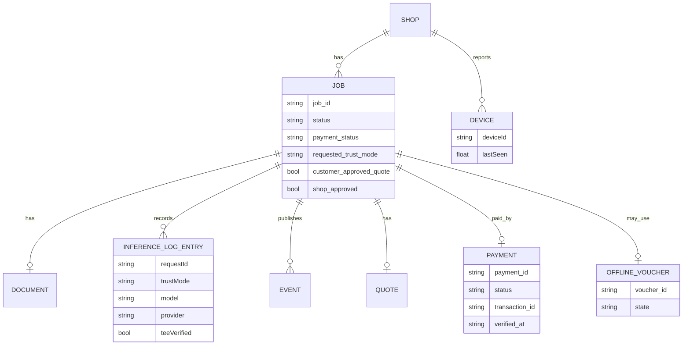

The mobile app has its own SQLite database (paired shops and job rows, no keys or document contents).

---

## 13. Shop hardware roles

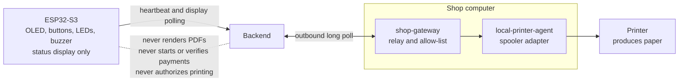

| Component | Role | Is not |
|---|---|---|
| Printer | Produces paper | |
| local-printer-agent | Lists printers, validates settings, submits a PDF to the Windows spooler | A queue or history store |
| shop-gateway | Outbound relay, runs four allow-listed adapter calls, fetches the PDF through a one-time reference | A durable queue, or an authorizer |
| ESP32-S3 (`hardware/inklink_display`) | Local status display | A PDF renderer, a gateway or a payment actor |

The ESP32 firmware is standalone published source, not verified on hardware by the committer.

---

## 14. Offline-first status

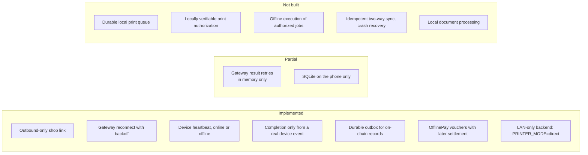

Security rule for any future offline mode: offline execution must never bypass payment verification or print authorization. A job may run offline only with a backend-issued, job-bound, expiring authorization that the gateway can verify locally. That authorization does not exist yet.

---

## 15. Roadmap

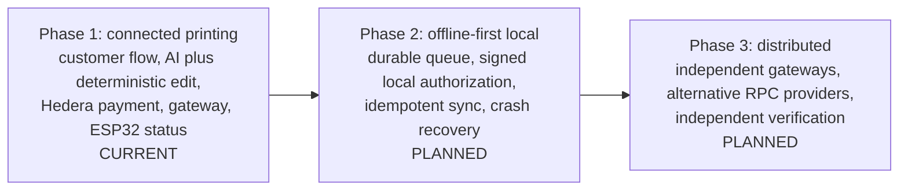

To finish Phase 1: run the shop gateway against the hosted backend, deploy the 0G registry contract, prove one full print on real hardware.

---

## 16. Evidence checklist for the 0G criteria

| Criterion | Status | Evidence |
|---|---|---|
| Inference on 0G Private Computer | Live | `services/backend/app/zerog.py` (`chat_completion`), model `glm-5.3`, three trust-mode keys configured (`/health` reports `zeroG.modes`). |
| Inference in the main user flow | Live | Every AI operator run goes through the inference gateway: section 4. The only exception is the jury demo's labelled deterministic operator, which uses no model and is refused for real shops. |
| Request IDs | Built and shown | Logged per call (`inference.py`), shown in the Agent Workspace and in `GET /api/v1/jobs/{id}` at `privacy.lastInference.requestId`. |
| Working application | Live | Hosted URLs in the README. Checked HTTP 200 on 2026-11-06 for `/portal`, `/jury`, `/demo` and the backend `/health`. |
| What breaks without 0G | Stated | README, "Built on 0G". |
| Public repo, README, setup | Yes | MIT licence, README, `deploy/gcp/README.md`. |
| Demo video, 3 minutes | Not in the repo | Add the link where the submission asks for it. |
| On-chain record on 0G Galileo | Not deployed | Contract written and tested (5 tests). Needs a funded deployer key. |
| iAI sign-in and per-user credit consumption | Not built | Inference is paid with the operator's own 0G keys. Optional bonus. |
